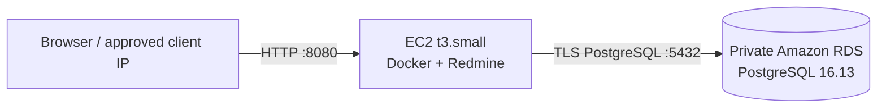

# Lab 5 – AWS RDS PostgreSQL with Redmine

## Overview
This repository documents Lab 5 Assignment 1: restoring the Lab 4 Redmine PostgreSQL database to Amazon RDS for PostgreSQL and running a separate Redmine application on EC2 against RDS.

**Application:** http://43.204.115.17:8080  
**AWS Region:** `ap-south-1` (Mumbai)  
**Database:** PostgreSQL 16.13, `db.t3.micro`, 20 GiB encrypted gp3  
**Database name:** `redmine`

> Port 8080 was restricted to the operator's public IPv4 `/32` at setup time. Update that rule to the demonstrator's current IP before a live demonstration. Do not open it to `0.0.0.0/0`.

## Architecture



- A separate Docker Compose Redmine project runs on EC2 and publishes host port `8080` to container port `3000`.
- RDS is private (`PubliclyAccessible = false`).
- RDS inbound TCP `5432` is allowed only from the EC2 security group.
- The Redmine-to-RDS connection requires PostgreSQL TLS (`PGSSLMODE=require`).
- The original Lab 4 Redmine containers and local PostgreSQL database remain separate and were preserved.

## AWS resources

| Resource | Configuration |
|---|---|
| Region | `ap-south-1` |
| EC2 | `t3.small`, Ubuntu 24.04 |
| Application port | TCP `8080`, restricted to one IPv4 `/32` |
| RDS identifier | `vedant-lab5-postgres` |
| Engine | PostgreSQL 16.13 |
| Instance class | `db.t3.micro` |
| Storage | 20 GiB encrypted gp3 |
| Database | `redmine` |
| RDS access | Private; TCP 5432 from EC2 security group only |
| Backup retention | 1 day |
| Deletion protection | Enabled |

RDS endpoint:
`vedant-lab5-postgres.c3a6k8gg8ony.ap-south-1.rds.amazonaws.com`

## Deployment layout on EC2

```text
/opt/lab5-redmine-rds/
├── compose.yaml
├── .env                 # secrets; never commit
└── api_token            # Redmine API token; never commit
```

The deployed Redmine image is pinned to the image digest used during the lab.

## Configuration
A sanitized Compose example is in [deployment/compose.yaml](deployment/compose.yaml). Create a private `.env` file on EC2. Never commit `.env`, API tokens, database passwords, AWS access keys, or secret key bases. See [deployment/.env.example](deployment/.env.example) for variable names only.

## Database migration
A PostgreSQL custom-format backup of the Lab 4 database was restored into the RDS database `redmine`. The restored data was verified through the Lab 5 Redmine application. The original Lab 4 local database was preserved.

## CRUD verification

| Operation | Evidence |
|---|---|
| CREATE | Created a temporary project through `POST /projects.json` |
| READ | Retrieved it through `GET /projects/{id}.json` |
| UPDATE | Updated description and set project private through `PUT /projects/{id}.json` |
| DELETE | Deleted the temporary project; API returned `HTTP 204 No Content` |

The final project listing confirmed that the original Lab 4 project remained. The earlier Lab 5 evidence project was retained.

## Screenshots
The evidence index is in [docs/evidence-index.md](docs/evidence-index.md). Screenshots belong in `docs/screenshots/` and should be named:

1. `01_Redmine_Application.png`
2. `02_RDS_Database_Status.png`
3. `03_RDS_PostgreSQL_Configuration.png`
4. `04_RDS_Security_Group.png`
5. `05_EC2_Instance_Details.png`
6. `06_CRUD_Create.png`
7. `07_CRUD_Read.png`
8. `08_CRUD_Update.png`
9. `09_CRUD_Delete.png`
10. `10_Final_Project_Verification.png`
11. `11_RDS_Database_Records.png`

Only add screenshots that show successful results. Redact passwords, API tokens, and other sensitive values before publishing.

## Security
- RDS is not publicly accessible.
- RDS port 5432 is not open to the internet.
- EC2 port 8080 is restricted to an IPv4 `/32`.
- Redmine-to-RDS traffic uses TLS.
- API token and `.env` remain on EC2 with restrictive permissions.
- No AWS access keys or application secrets belong in Git.

## Deployment outline
1. Provision a private PostgreSQL RDS instance in `ap-south-1`.
2. Allow TCP 5432 to RDS only from the EC2 security group.
3. Restore the database backup to RDS using a secure method.
4. Create the private `.env` file on EC2.
5. Deploy the separate Redmine Compose project.
6. Restrict TCP 8080 to the demonstrator's current public IP.
7. Verify the browser application and authenticated REST API CRUD operations.

## Cleanup
Do not remove the original Lab 4 application, local PostgreSQL container, database volume, or its security group rules during Lab 5 cleanup. Delete only explicitly identified temporary Lab 5 test records/resources.
